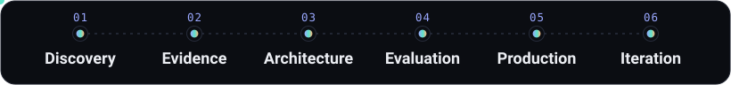

<p align="center">
  <picture>
    <source media="(prefers-color-scheme: dark)" srcset="assets/banner-dark.svg">
    <source media="(prefers-color-scheme: light)" srcset="assets/banner-light.svg">
    
  </picture>
</p>

<p align="center">
  <a href="https://iremnurgocer.github.io/?lang=en"></a>
  <a href="https://linkedin.com/in/iremnurgocer"></a>
  <a href="mailto:iremnurgocer99@gmail.com"></a>
  
</p>

---

### Hi, I'm İrem 👋

I'm a **Senior AI Engineer** at IC Holding in Ankara, with a background in mathematics
and computer science and **5+ years of software engineering** behind me — backend,
integrations, legacy modernisation, clinical decision support and intelligent transport
systems.

Today I build **enterprise AI systems that actually ship**: retrieval-augmented
generation, agentic workflows, document intelligence and the evaluation that keeps
them honest. On a typical
project I start by defining the problem with the business team, then own the
architecture, the implementation, the evaluation harness, the Azure deployment and the
handover to IT.

Because I came from backend engineering, I treat systems with an LLM in them exactly
like any other software: **they need tests, monitoring and limited permissions.**

```text
rules and maths ->  deterministic code, never the model
the model       ->  extraction and judgement, always auditable
every output    ->  bound to a quote or a source id, or dropped
access control  ->  in the retrieval filter, fail-closed by default
unknowns        ->  stay "unknown"; unmeasured stays "unmeasured"
```
---

### How I work

<p align="center">
  <picture>
    <source media="(prefers-color-scheme: dark)" srcset="assets/pipeline-dark.svg">
    <source media="(prefers-color-scheme: light)" srcset="assets/pipeline-light.svg">
    
  </picture>
</p>

**01** define the costly mistake with the business team · **02** map the sources,
the permissions and what a "right answer" rests on · **03** rules and SQL in code,
the model only where it adds value · **04** golden set, UAT and regression runs ready
before launch · **05** Azure serverless, IaC, managed identity, observability, handover ·
**06** feedback, review queues and human-approved examples

Model selection is usually the *last* conversation. First comes the problem, where the
data comes from, and how we will know it worked.

---

### Production work

Most of what I build is behind a corporate firewall, so client and system names are left
out. Each one is written up as a full case study — problem, architecture, trade-offs and
results:

| | System | What it does | Stack |
|---|---|---|---|
| 🧾 | **[Spec & pre-qualification analysis agent](https://iremnurgocer.github.io/work/spec-analysis-agent.html?lang=en)** | Turns long tender specifications into an executive brief, pass/fail criteria and a scoring table — every item bound back to the clause it came from. 94–100% recall against the team's manual summaries, **zero fabricated items** across every evaluation run. | Python · Azure Functions · Azure OpenAI · Bicep |
| 🔍 | **[Decision archive assistant](https://iremnurgocer.github.io/work/decision-archive-assistant.html?lang=en)** | Natural-language search over a large decision archive. The expensive mistake here is *missing* a decision, so the whole system is designed for recall. 99% of user acceptance tests passed. | Azure AI Search · Azure OpenAI · Teams · OpenTelemetry |
| 🌍 | **[Document translation & terminology](https://iremnurgocer.github.io/work/document-translation.html?lang=en)** | Translation for corporate documents that keeps layout and house terminology intact, with a reviewer in the loop where the text carries legal weight. | Python · Azure OpenAI · Azure Functions |

→ [More case studies](https://iremnurgocer.github.io/?lang=en#work): supplier extraction and tender intelligence.

**14** enterprise AI projects shipped · **2** academic papers (TURABDIN 2025) · **5+** years engineering

---

### Public projects

Most of what I build day to day lives in private company repositories.
These are the ones I can share:

| Project | What it is |
|---|---|
| **[Üretimde LLM Mühendisliği](https://github.com/iremnurgocer/uretimde-llm-muhendisligi)** `Türkçe` `Python` | A handbook on taking AI systems over Turkish documents from demo to production — every chapter ships runnable, dependency-free code and a measurement. Starts with why `str.lower()` is wrong in Turkish and what that quietly costs you in retrieval (recall@3: 58% → 100%). |
| **[ChatCore.AI](https://github.com/iremnurgocer/ChatCore.AI)** `Python` | A RAG assistant for company data: FAISS + BM25 hybrid retrieval with optional cross-encoder re-ranking, persistent chats in PostgreSQL, role-based access, and five swappable providers (Gemini, OpenAI, Azure OpenAI, Ollama, HuggingFace). FastAPI + Streamlit. |
| **[ai-api-gateway](https://github.com/iremnurgocer/ai-api-gateway)** `Python` `Node.js` | An API gateway that scores every incoming request for risk in real time with an Isolation Forest model and blocks the suspicious ones. JWT auth, Redis rate limiting, automatic retraining from traffic logs, Prometheus + Grafana. |
| **[borsa-anomali](https://github.com/iremnurgocer/borsa-anomali)** `Python` | Anomaly detection on market data — pulls candles from 100+ exchanges through `ccxt` and flags abnormal price moves with three different ML methods. |
| **[task-manager-api](https://github.com/iremnurgocer/task-manager-api)** · **[client](https://github.com/iremnurgocer/task-manager-client)** `TypeScript` | A full-stack reference build: Express + Sequelize REST API with JWT auth, bcrypt, validation, rate limiting and Jest tests, plus a React 19 + Vite SPA with protected routes. |
| **[qr-generator](https://github.com/iremnurgocer/qr-generator)** `Python` | FastAPI QR code studio — custom colours, embedded logos, SVG export and a history of your last designs. |
| **[COMMAND-GUIDE](https://github.com/iremnurgocer/COMMAND-GUIDE)** `Docs` | A 10-chapter cross-platform terminal reference: the same task side by side in Windows CMD, PowerShell, macOS and Linux. |
| **[iremnurgocer.github.io](https://github.com/iremnurgocer/iremnurgocer.github.io)** `HTML` | My portfolio — bilingual TR/EN, no build step, a WebGL "evidence network" hero, a ⌘K command palette, two in-browser lab demos and a chat assistant that answers questions about my work. |

---

### Writing

Long-form notes on the things I keep running into, published on the portfolio in both Turkish and English:

- [**Enterprise RAG: from prototype to production**](https://iremnurgocer.github.io/blogs/rag-production.html?lang=en) — chunking, hybrid retrieval, citation guards and what breaks at scale
- [**Natural language to SQL: a safe Text-to-SQL architecture**](https://iremnurgocer.github.io/blogs/text-to-sql.html?lang=en) — AST validation, row-level security, repair loops
- [**Agentic AI: agent architectures and multi-agent systems**](https://iremnurgocer.github.io/blogs/agentic-ai.html?lang=en) — when more agents help and when they just add latency
- [**Penetration testing, security engineering and defensive operations**](https://iremnurgocer.github.io/blogs/security-engineer-training.html?lang=en)
- [**Microservice architecture: review and integration methods**](https://iremnurgocer.github.io/blogs/blog1.html?lang=en)

---

### Working stack

<p align="center">
  
</p>

| | |
|---|---|
| **AI / ML** | Azure OpenAI · Azure AI Search · RAG (hybrid BM25 + vector, re-ranking) · multi-agent orchestration · evaluation harnesses, golden sets, LLM-as-judge |
| **Backend** | Python (FastAPI) · .NET / ASP.NET Core · Node.js & TypeScript · REST & async job APIs · PHP (Laravel, Symfony) |
| **Data** | PostgreSQL · MSSQL · Oracle · MongoDB · Redis · row-level security, enforced in the data layer |
| **Platform** | Azure Functions & serverless · Bicep / IaC · managed identity · Docker · CI/CD · OpenTelemetry |
| **Also** | application security, penetration testing and secure coding — the habits I bring to AI systems |

---

<p align="center">
  <sub>
    Open to conversations about enterprise AI, collaborations and speaking.<br>
    <a href="https://iremnurgocer.github.io/?lang=tr">Türkçe sürüm</a> ·
    <a href="mailto:iremnurgocer99@gmail.com">iremnurgocer99@gmail.com</a>
  </sub>
</p>
